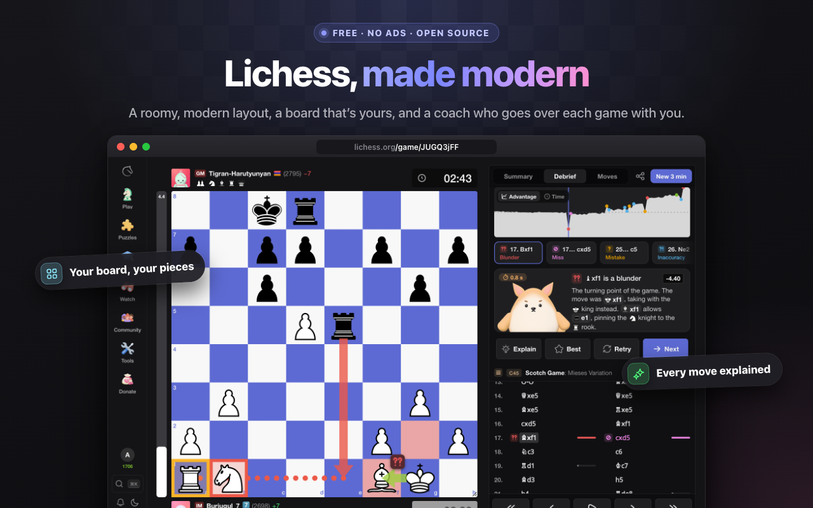
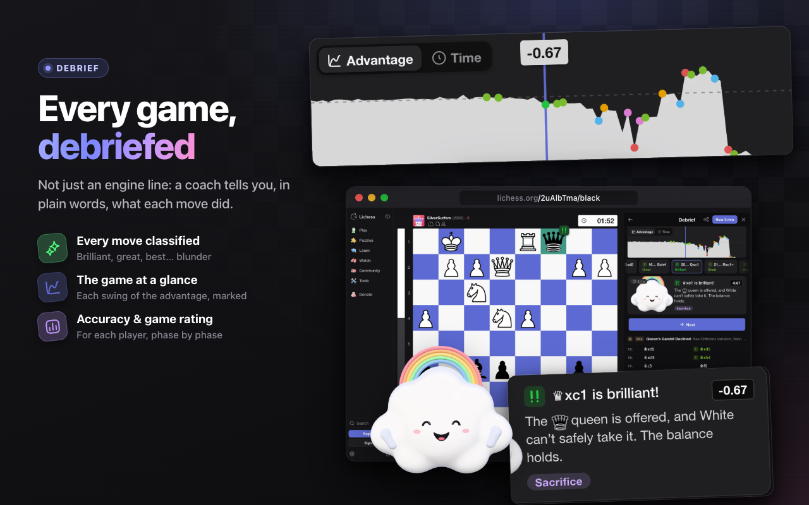
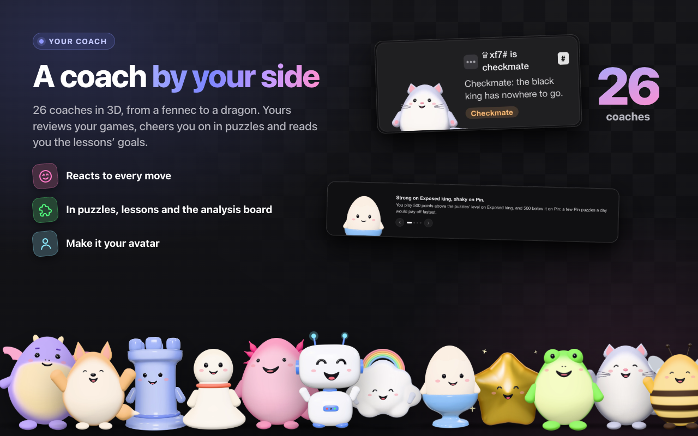
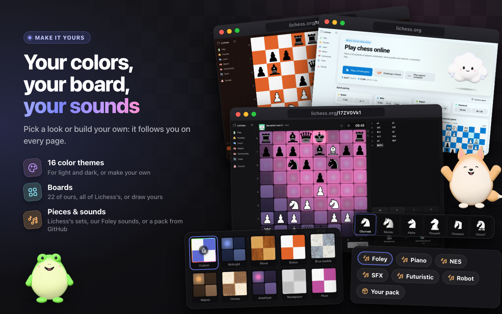
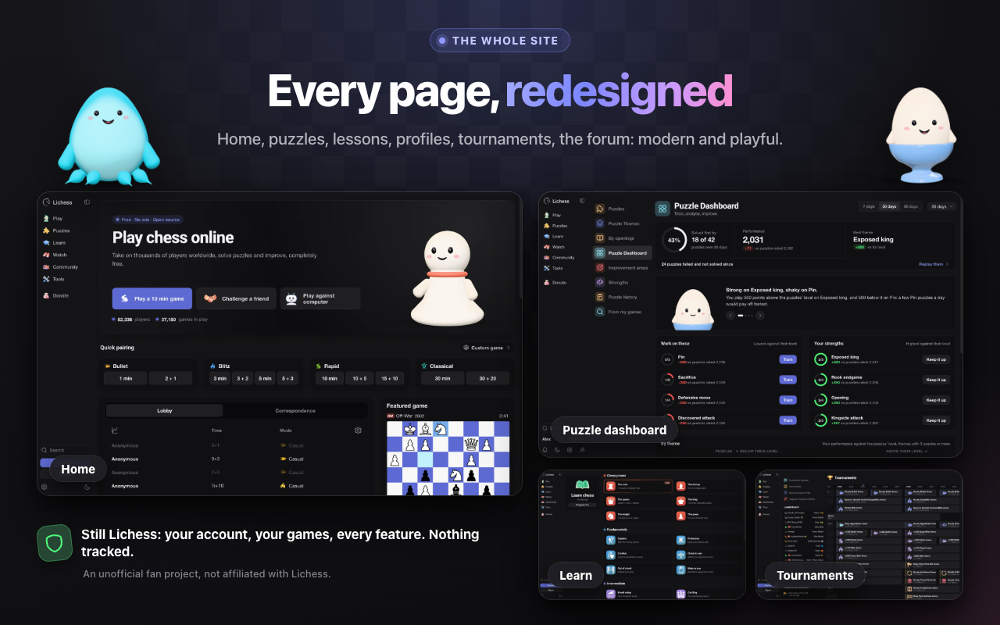

# Lichess Neo

Lichess is free, open source and has no ads. This Chrome extension gives it
a modern look and feel: a roomy layout, playful pages, a coach by your side,
the colors, board, pieces and sounds of your choice, and a Debrief after every
game.

Your Lichess account, your games and your friends don't change. Only the look
and the sounds do.



## What you get

### A roomy layout

A sidebar on the left, player bars with avatars and clocks above and below
the board, and one panel on the right for the moves and the chat. It's laid
out for tablets and phones too.

### A Debrief after every game

Open any finished game and you get a full debrief: a graph of the advantage
with its turning points marked, each player's accuracy, a rating for how well
they played, and every move marked brilliant, great, best, mistake, blunder…
A coach then takes you through the game move by move, in plain words.



### A coach by your side

Pick one of 26 coaches in 3D, from a fennec to a dragon. Yours reviews your
games, cheers you on in puzzles and reads you the lessons' goals, and it can
be your avatar too.



### Your colors, your board, your sounds

16 color themes, for Lichess's light and dark modes, or one you make in the
settings' theme editor. Boards: 22 of the extension's, all of Lichess's, or
one you draw. Pieces and sounds: Lichess's sets or the extension's Foley
sounds.

Or bring your own: put them in a folder on GitHub with a `pack.json`, paste
its link in the extension's settings (**Packs**), pick them in **Board &
sounds**, and they're yours on every page. Private repositories work too,
with a token. How to make one: [docs/packs.md](docs/packs.md), and a pack to
start from: [packs/example](packs/example).



### The rest of the site too

Home, puzzles, lessons, profiles, tournaments, the forum: every page gets the
same treatment, on any screen.



## Install it

If you want to install it directly from GitHub:

1. Download `LichessNeo-v….zip` from the
   [latest release](https://github.com/theophile-wallez/LichessNeo/releases/latest)
   and unzip it into a folder you'll keep.
2. In Chrome, open `chrome://extensions`.
3. Turn on **Developer mode**, top right.
4. Click **Load unpacked** and choose the unzipped folder (the one with
   `manifest.json` in it).
5. Open [lichess.org](https://lichess.org).

It also works in Edge, Brave, Arc, Opera and Vivaldi: the steps are the same,
from their own extensions page. Safari isn't supported.

### In Firefox

Firefox 140 or later. It has its own package:

1. Download `LichessNeo-v…-firefox.zip` from the
   [latest release](https://github.com/theophile-wallez/LichessNeo/releases/latest).
2. In Firefox, open `about:debugging#/runtime/this-firefox`.
3. Click **Load Temporary Add-on…** and choose the ZIP.
4. Open [lichess.org](https://lichess.org).

Firefox only keeps an extension it hasn't had signed by Mozilla until you quit
it: load it again after a restart.

Leave the folder where it is: the browser loads the extension from it, so
moving or deleting it removes the extension.

**To update**, download the new release's ZIP and replace the folder's files with the
new ones. The extension reloads on its own the next time you go back to a
Lichess tab.

**To remove it**, click **Remove** on its card in `chrome://extensions`.

## Good to know

- It fits every screen: a computer's, a tablet's or a phone's.
- Its images come with it: it loads nothing from other sites, except the
  packs you import, once, from GitHub.
- Nothing is tracked or collected.

## Development

The extension is written in TypeScript and bundled with
[rolldown](https://rolldown.rs). You need Node.js 24 and pnpm
(`corepack enable` installs the version the repository pins).

```bash
pnpm install
pnpm dev    # builds dist/chrome, then again on every change
```

Load `dist/chrome` with **Load unpacked** in `chrome://extensions`. It reloads
itself when you go back to a Lichess tab after a rebuild (a `--release` build
doesn't).

`pnpm check` runs the type checks, the linter, the formatting check and the
unit tests (`pnpm check:fast` only those of the files changed since
`origin/main`), and `pnpm test:e2e` the end-to-end smoke tests on
lichess.org (after `pnpm build`), which CI runs on every push. How the code is organized:
[docs/architecture.md](docs/architecture.md).

### Building from the sources

`pnpm package` also zips the sources each version is built from,
`LichessNeo-v<version>-source.zip`. To rebuild the add-on from them, with
Node.js 24 and pnpm, in the unzipped folder:

```bash
pnpm install --frozen-lockfile
pnpm build --target firefox --release --version <version>
```

`dist/firefox` is then the add-on, file for file. From a full clone (not
`--depth`) at the release's tag `v<version>`, `pnpm package` writes every package
into `dist/`: the version counts the commits.

## Disclaimer

This is a free, personal fan project, made for fun. It isn't sold, it shows
no ads, it asks for no money, and it's not meant to make money in any way.

It isn't affiliated with, endorsed by or sponsored by Lichess, Chess.com or
any other chess site or company, and uses none of their names for its
features. Its images are its own or under free licenses: the bundled
packages' ship in each build's `licenses` folder
([scripts/lib/licenses.ts](scripts/lib/licenses.ts)), the example pack's are in
[packs/example](packs/example);
Lichess's own board, pieces and sounds come from lichess.org itself. A pack you
import is yours: share only what you may share.

If you own something used here and want it gone, please
[open an issue](https://github.com/theophile-wallez/LichessNeo/issues) and it will be removed promptly.

The extension only changes how Lichess looks and sounds in your browser. It
doesn't touch your account, and it gives no help during a game you're
playing: using an engine in a live game breaks Lichess's rules, so don't.

It comes as is, with no warranty of any kind. A Lichess update can break it
at any time. You use it at your own risk, and the author can't be held
responsible for any problem that comes from using it. See the
[license](LICENSE) for the full terms.

## License

[MIT](LICENSE)
