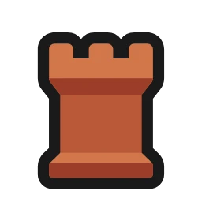
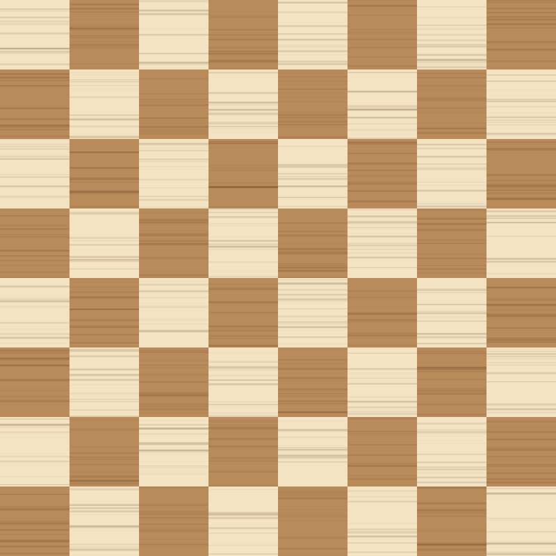
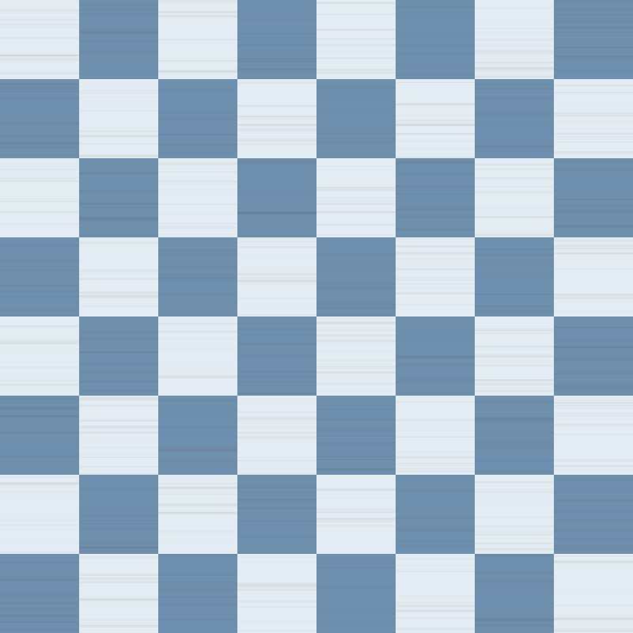
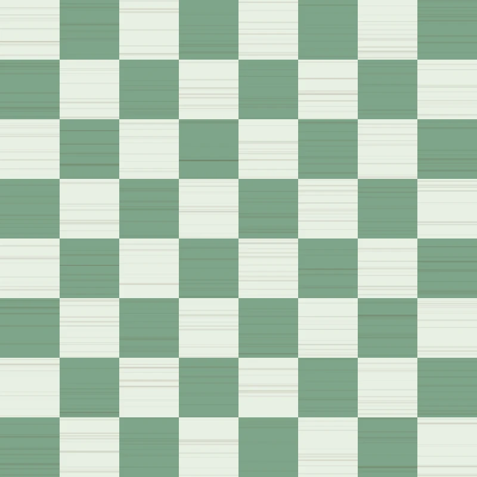

# Samples

Files to try the **Packs** card of the extension's settings with, in every
format it takes. Drop one of these folders (or some of its files) on the
zone of its kind: a dialog opens, with each file already in its place. Name
what you import, fill in what's missing if anything is, and import it.

To download a file, open it and use the download button at the top right of
its page; [warm-wood.zip](../warm-wood.zip) holds the whole example pack in
one download. Written by `scripts/example-samples.ts` from
[the example pack](../example).

## Pieces

Twelve images, each named by its color (`w`, `b`) and its role (`K`ing,
`Q`ueen, `R`ook, `B`ishop, k`N`ight, `P`awn): `wK.png` … `bP.png`. Any
other name works too, placed by hand in the dialog.

| Format | Folder                                    |                                                                                                                                  |
| ------ | ----------------------------------------- | -------------------------------------------------------------------------------------------------------------------------------- |
| PNG    | [`pieces-png/`](pieces-png)               |          |
| WebP   | [`pieces-webp/`](pieces-webp)             |    |
| SVG    | [`../example/pieces/`](../example/pieces) |                                    |

## Boards

One image of the 64 squares, `a8` at the top left, under any name. The
coordinates take its squares' colors.

| Format | File                                           |                                             |
| ------ | ---------------------------------------------- | ------------------------------------------- |
| PNG    | [`boards/maple.png`](boards/maple.png)         |      |
| JPEG   | [`boards/harbor.jpg`](boards/harbor.jpg)       |     |
| WebP   | [`boards/mint.webp`](boards/mint.webp)         |      |
| SVG    | [`../example/board.svg`](../example/board.svg) |  |

## Sounds

Each named after what it plays on: `move-self`, `capture`, `castle`… (the
whole list is in [docs/packs.md](../../docs/packs.md#packjson)). Any other
name works too, placed by hand in the dialog, and a set needs only some of
them: Lichess plays the others.

| Format | Folder                                    |
| ------ | ----------------------------------------- |
| MP3    | [`sounds-mp3/`](sounds-mp3)               |
| Ogg    | [`sounds-ogg/`](sounds-ogg)               |
| WAV    | [`../example/sounds/`](../example/sounds) |

All of them are under [CC0 1.0](https://creativecommons.org/publicdomain/zero/1.0/),
as the example pack's are: the pieces are the RhosGFX set, the boards are
drawn by the script, and the sounds are synthesized by
`tools/example-pack/sounds.py`.
